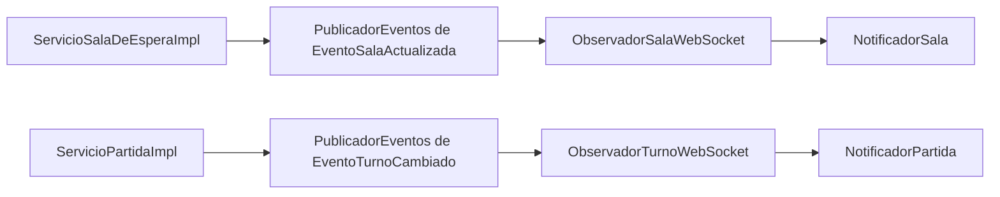

# Observer en sala de espera y turnos

Se aplica Observer mediante composición: los servicios publican cambios y los observadores
suscritos reaccionan a ellos. El servicio no conoce a los notificadores WebSocket concretos.
La implementación no requiere descargar ninguna biblioteca adicional.

## Organización

```text
src/main/java/com/tallerwebi/
├── dominio/
│   ├── eventos/
│   │   ├── EventoSalaActualizada.java
│   │   └── EventoTurnoCambiado.java
│   ├── observadores/
│   │   └── Observador.java
│   ├── publicadores/
│   │   └── PublicadorEventos.java
│   └── servicios/
│       ├── ServicioSalaDeEsperaImpl.java
│       └── ServicioPartidaImpl.java
├── presentacion/WebSocket/
│   ├── observadores/
│   │   ├── ObservadorSalaWebSocket.java
│   │   └── ObservadorTurnoWebSocket.java
│   ├── NotificadorSala.java
│   └── NotificadorPartida.java
└── config/
    ├── ObservadoresConfig.java
    └── SpringWebConfig.java
```

Las pruebas nuevas están en las carpetas equivalentes de `src/test/java/com/tallerwebi/`:
`dominio/publicadores`, `dominio/eventos` y `config`.

## Participantes del patrón

| Papel | Clase | Responsabilidad |
|---|---|---|
| Interfaz observadora | `Observador<T>` | Define `actualizar(T evento)`. |
| Publicador | `PublicadorEventos<T>` | Permite suscribir, desuscribir y notificar. |
| Datos del cambio | `EventoSalaActualizada`, `EventoTurnoCambiado` | Capturan el estado a comunicar. |
| Observadores concretos | `ObservadorSalaWebSocket`, `ObservadorTurnoWebSocket` | Adaptan los eventos a los DTO existentes. |
| Configuración | `ObservadoresConfig` | Registra cada observador en su publicador. |
| Emisores | Los servicios de sala y partida | Ejecutan la operación y publican su resultado. |

`T` representa el tipo de evento. Spring distingue los dos publicadores por ese tipo:
un observador de sala no recibe cambios de turno.

Los observadores Java son componentes del servidor. Los jugadores siguen recibiendo mensajes
por WebSocket; el código de sala incluido en cada evento determina el destino correspondiente.



## Comportamiento conservado

- Al unirse, abandonar una sala o cambiar de ficha, el servicio publica su estado actualizado.
- Si hay una transacción activa en la sala, publica después del commit. Un rollback no notifica.
- El evento de sala copia sus colecciones; los cambios posteriores no alteran la notificación pendiente.
- El inicio y avance de turno, y el inicio de su temporizador cuando corresponde, mantienen sus avisos.
- Los destinos WebSocket, mensajes y campos JSON siguen siendo los existentes.
- Los temporizadores y las operaciones de dinero permanecen bajo control de los servicios.

El publicador entrega los eventos de forma síncrona. No crea hilos ni tareas en segundo plano.
Si un observador lanza una excepción, esta se propaga y se interrumpe la entrega a los siguientes.
La lista admite suscripciones concurrentes: las altas y bajas realizadas durante una entrega
se reflejan en la siguiente notificación. Suscribir dos veces el mismo observador no duplica avisos.

## Agregar otro observador

1. Implementar `Observador<EventoSalaActualizada>` o `Observador<EventoTurnoCambiado>`.
2. Colocarlo en la capa que corresponda a su tarea; un observador de persistencia iría en infraestructura.
3. Registrarlo como componente Spring en un paquete escaneado. `ObservadoresConfig` recibe la lista
   de observadores de cada tipo y los suscribe automáticamente.

No es necesario modificar los servicios ni el publicador para agregar esa reacción.
También se puede usar `suscribir` o `desuscribir` explícitamente si la suscripción es temporal.

Referencia: [Observer de Refactoring Guru](https://refactoring.guru/es/design-patterns/observer).
